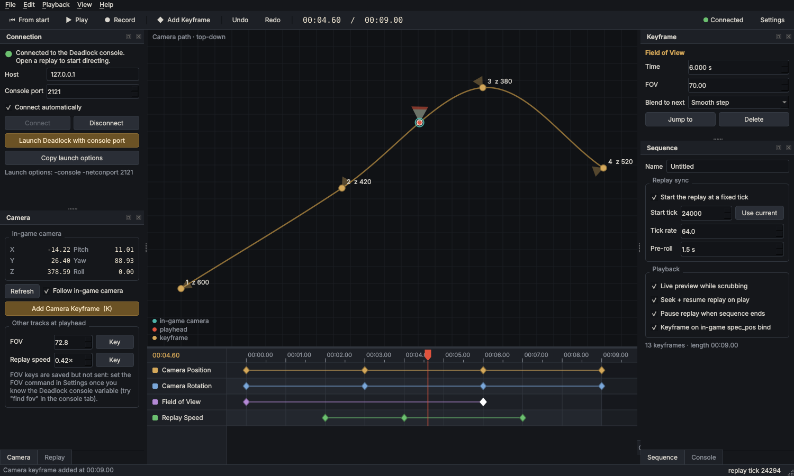

# Deadlock Director

A cinematic camera sequencer for **Deadlock** replays, inspired by Riot Games'
[League Director](https://github.com/riotgames/leaguedirector).

Fly the replay free-cam to a spot, drop a keyframe, move the playhead, fly somewhere else, drop another.
Deadlock Director blends between them with spline paths and easing curves, and can slow the replay down
over time. It can also seek the replay to the same tick for every take and record the shot through OBS.



## How it talks to Deadlock (and why it's anti-cheat friendly)

League has an official Replay API. Deadlock doesn't, so Deadlock Director uses the one interface the game
already provides for this: **its own developer console**.

Source 2 games can open that console to local programs in two ways, and Deadlock Director speaks both:

* the **network console**, a plain-text port opened with the `-netconport <port>` launch option, and
* **VConsole**, the protocol Valve's own VConsole2 tool uses (port 29000), requested with `-vconsole`.

By default the app tries both and uses whichever answers. Either way it types the same console commands you could
type by hand (`spec_goto`, `spec_pos`, `demo_pause`, `demo_timescale`, …).

> **Status:** in testing so far, Deadlock ignored `-netconport`, and `-tools` mode crashed at startup
> ("Unable to load module modtools"), because Valve doesn't ship its developer tools to players. `-vconsole` is
> being tested next.

What it **does not** do:

* read or write game memory
* inject DLLs or hook the renderer
* simulate keyboard or mouse input
* modify game files
* use `-insecure` or anything else that turns VAC off
* enable `sv_cheats`. Moving and pointing the camera (`spec_goto`, `spec_setang`) are ordinary spectator commands, not cheat commands.

To detect the game it only lists running process names (`deadlock.exe`) and reads Steam's library files to
find the install folder. Camera commands only work while you are spectating or watching a replay, so the app
can't give an advantage in a live match.

> No third-party tool can be *guaranteed* safe. Valve controls VAC. This app uses only documented engine
> features and console commands, which is the lowest-risk approach available. To be extra careful, use the
> **Launch Deadlock with console port** button, which adds the option for that one launch only, and launch
> normally for ranked play.

## Quick start (Windows)

1. Download **`DeadlockDirector.exe`** from the [latest release](../../releases/tag/latest) and double-click it.
   There's also a `.zip` version that starts faster: unzip it and run `DeadlockDirector.exe` inside.
   Windows SmartScreen may warn about an unsigned app: click *More info → Run anyway*.
2. In the **Connection** panel click **Launch Deadlock with console port**, or add this to
   *Steam → Deadlock → Properties → Launch Options*:

   ```
   -console -netconport 2121
   ```
3. In Deadlock open a replay (*Match history → Watch replay*). The status turns green (**Connected**).
4. Release the camera into free-cam (WASD), fly to your first spot and press **K**.
5. Move the playhead (click the ruler or press → a few times), fly to the next spot, press **K** again.
6. Press **Space** to play the shot.

**Running from source instead:** install [Python 3.10+](https://www.python.org/downloads/) and double-click `run.bat`.
The first run creates a virtual environment and installs the dependencies.

The Windows builds come from `.github/workflows/build.yml`. Every push to `main` runs the tests, builds with
PyInstaller and refreshes the `latest` release.

## Troubleshooting the connection

Click **Diagnose connection** in the Connection panel. It checks whether Deadlock is running, which TCP ports it
has opened, and what each one is: network console, VConsole, web server or unknown. It listens first and only sends
a harmless `echo` line to ports that stay silent. The port list comes from Windows' connection table (the same list
`netstat -ano` prints), not from the game. When it finds a working console on another port, it switches the app to it.

| Diagnosis | Meaning / fix |
| --- | --- |
| Deadlock is not running | Start the game. If it *is* running, check its `.exe` name in Task Manager → Details and open an issue. |
| No console port open | Deadlock ignored the launch options. Try `-console -vconsole` in the **Deadlock launch options** box, quit Deadlock completely, start it again and re-run Diagnose. |
| Console / VConsole on a different port | Found automatically, and the app switches to it. |
| Port used by another program | Pick another port number in both the app and the launch options. |

Notes:
* Launch options only apply when the game *starts*. If Deadlock was already open, restart it.
* The **Launch Deadlock with these options** button makes Steam show a confirmation prompt, and the options are ignored if you dismiss it.
* There's no way to open a console port after the game has started. It has to be a launch option.
* Don't use `-tools`: Deadlock doesn't ship the developer files it needs and fails with "Unable to load module modtools".

## Smooth path test (Tools menu)

Deadlock opens no console port to outside programs, but it does run `exec <file>` from a key bind. **Tools → Smooth
path test** checks whether that can drive a smooth camera path. About 30 times a second, the app writes the next
camera position to `cfg/ddir_frame.cfg` and taps a key you've bound to `exec ddir_frame`, so the game loads each frame
itself. The test path orbits the point you're looking at, read from `spec_pos` output in the `-condebug` console log.

> ⚠️ This sends simulated key presses to Deadlock (only while it is the active window), the same mechanism macro tools
> such as AutoHotkey use. It never reads or writes game memory. Valve doesn't publish rules on simulated input, so use
> it in the replay viewer only, and only if you're comfortable with that.

## Features

* **Auto-detect and connect**: spots `deadlock.exe` and connects as soon as the console port opens.
* **Sequencer timeline** with four tracks: camera position, camera rotation, field of view and replay speed.
  * Blend modes per keyframe: spline (smooth through every point), linear, smooth step, ease in/out, hold (hard cut).
  * Drag to retime (snaps to the playhead and other keys; hold Alt to disable snapping), box-select, Shift/Ctrl multi-select.
  * Undo / redo, save / load (`.ddseq` JSON).
* **Top-down path view** showing the camera path, keyframe facing and the live in-game camera.
* **Live preview**: scrubbing the timeline moves the in-game camera.
* **Replay sync**: stamp a start tick on the sequence and every take seeks there first, so takes are repeatable.
* **Speed ramps**: keyframe the replay speed for slow-motion moments. The camera clock follows the ramp so the path stays in sync with the action.
* **In-game capture bind**: run `bind KP_ENTER spec_pos` once in Deadlock's console. Every press of that key adds a camera keyframe at the playhead without leaving the game.
* **Clean feed**: one checkbox hides the HUD and replay controls (`citadel_hud_visible`, `citadel_hide_replay_hud`).
* **OBS recording**: *Record* seeks, starts OBS recording, plays the shot and stops OBS at the end (obs-websocket v5, built into OBS 28+).
* **Console tab** for typing raw commands and exploring (`find spec_`, `find fov`, …).
* **Every command is editable** in *Settings → Console commands*, so a Deadlock patch that renames something doesn't break the app.

### Keyboard shortcuts

| Key | Action |
| --- | --- |
| Space | Play / stop |
| Home | Play from start |
| K | Add camera keyframe from the in-game camera |
| ← / → | Step the playhead 1/30 s |
| Delete | Delete selected keyframes |
| Ctrl+A | Select all keyframes |
| F | Zoom timeline to fit |
| H | Toggle in-game HUD |
| Ctrl+R | Record with OBS |
| Ctrl+Z / Ctrl+Shift+Z | Undo / redo |
| Ctrl+wheel | Zoom timeline; wheel / middle-drag pans |

## ⚠️ Things to verify in your build of Deadlock

Deadlock is in active development and Valve publishes no documentation for its replay console. The defaults
below come from community observer guides and the Source 2 engine. Every one of them can be changed in
**Settings → Console commands**.

| What | Default | Status |
| --- | --- | --- |
| Console port | `-netconport 2121` | **Ignored by Deadlock in testing** (the port never opened). Kept in case Valve enables it. |
| VConsole | `-vconsole`, port 29000 | How Valve's VConsole2 tool connects to Source 2 games. `-tools` crashes Deadlock; `-vconsole` is **not yet confirmed**. |
| Move camera | `spec_goto x y z pitch yaw; spec_setang pitch yaw` | **Confirmed to exist** in Deadlock's console, neither cheat-flagged. `spec_setang` ("Points the spectator camera") is sent too because `spec_goto` alone was reported to ignore angles. |
| Read camera | `spec_pos` | Exists, but is flagged **cheat**, so it may need `sv_cheats 1` in a replay. The parser accepts any line with 5–6 numbers. |
| Pause / resume / seek / speed | `demo_pause`, `demo_resume`, `demo_gototick`, `demo_timescale` | **Confirmed to exist** in Deadlock's console, not cheat-flagged. |
| Read tick | `demo_info` + regex | Best effort. If **Use current** doesn't fill the start tick, type the tick in by hand. |
| Tick rate | 64 ticks/s | Unconfirmed for Deadlock. If seeks land in the wrong spot, change it in the Sequence panel. |
| FOV | *(disabled)* | No known spectator FOV variable yet. Type `find fov` in the Console tab, then fill in the command (e.g. `some_fov_cvar {value}`). |
| HUD | `citadel_hud_visible`, `citadel_hide_replay_hud` | From community guides. |
| Free-cam speed | `citadel_observer_roaming_speed` | From community guides (default 600). |

**First-run checklist:** open the Console tab and type `spec_pos`. The Camera panel should show numbers.
Then add two keyframes in different places and scrub between them. The game camera should move.

## How it works

```
 Deadlock Director                                   Deadlock (replay)
┌──────────────────────┐   TCP 127.0.0.1:2121       ┌────────────────────┐
│ timeline / sequencer │ ── "spec_goto x y z p y" ─▶│ developer console  │
│ playback @ 60 Hz     │ ── "demo_timescale 0.35" ─▶│ (-netconport)      │
│ console parser       │ ◀─ "spec_goto 1 2 3 4 5" ──│                    │
└──────────────────────┘                            └────────────────────┘
```

During playback the app evaluates the sequence at a fixed rate (60 updates/s by default, configurable) and
sends a camera command only when the value changed. Queries such as `spec_pos` are wrapped in
`echo` markers so their output can be told apart from the rest of the console.

## Development

```
pip install -r requirements-dev.txt
python -m pytest            # 22 tests; Qt runs headless
python tools/fake_deadlock.py --port 2121   # a stand-in console to develop against without the game
python -m deadlockdirector
```

`tools/fake_deadlock.py` implements the handful of commands the app uses, with a simulated camera and replay clock.

Project layout:

```
deadlockdirector/
  interpolation.py   easing curves, time-aware spline, angle unwrapping
  sequence.py        tracks / keyframes / save format / undo history
  console.py         console output parsing and command templates (pure Python)
  netcon.py          Source 2 network console client (QTcpSocket)
  game.py            high-level game controller, detection + auto-connect
  playback.py        real-time sequence player (replay sync, speed ramps)
  obs.py             OBS websocket v5 client for recording
  detect.py          process detection, Steam install lookup, Steam launch URL
  ui/                main window, timeline, path view, panels, settings
tools/fake_deadlock.py
tests/
```

Deadlock Director is a fan project. It is not affiliated with or endorsed by Valve.
